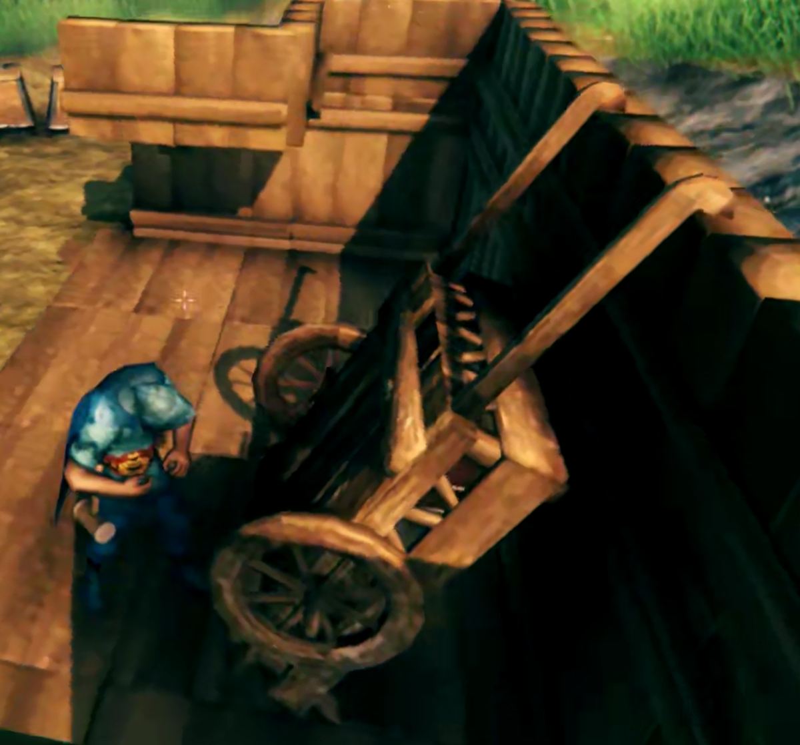
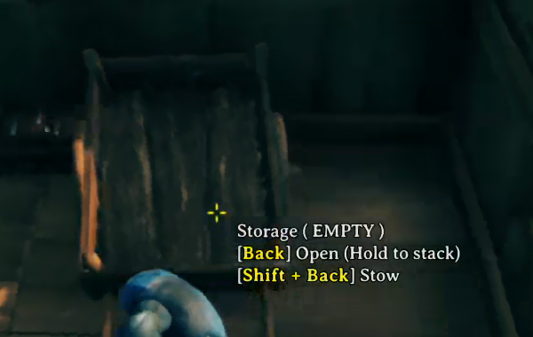
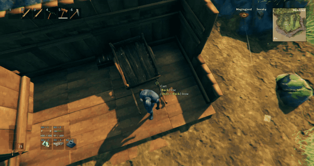
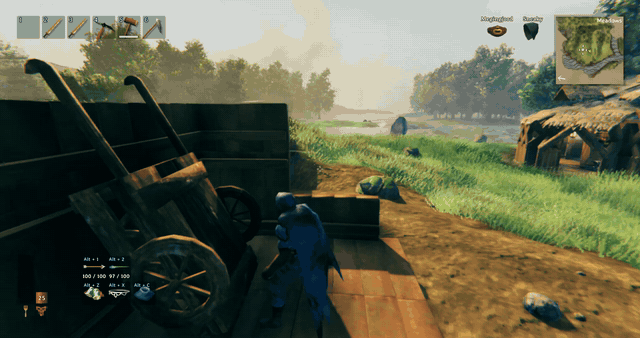
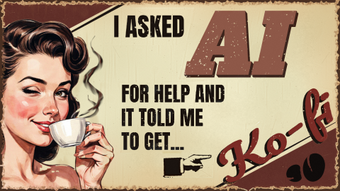

# Enigma's Tidy Cart

*Park your cart against the wall.*

Back your empty cart up to a tall wall, hold Shift and press Use, and your character tips it up against the wall, out of your way. Press Use on it to tip it back down. The animation plays on your character. Everyone on the server should have the mod.

## What it looks like

### The prompt

Look at the cart and the Stow line shows up next to the usual Use line. Your own Use key is shown, here it is bound to a mouse button.

### Stowing

You walk to the cart, crouch while it tips up against the wall, stand, step back and put your hands up with the armor animation, and finish with a thumbs up.

### Unstowing

The same in reverse: the cart tips back down onto its wheels while you walk back to the handles.

## Features

- Shift + Use on an empty cart stows it upright against a wall. Use on the stowed cart brings it back.
- The cart has to be backed up to a tall player-built wall, and there has to be room for it. If not, you get a short message in the middle of the screen.
- A cart with items in it cannot be stowed, and a stowed cart cannot be opened or grabbed.
- Your character walks to the cart and plays the whole thing out, and the cart tips smoothly instead of popping into place.
- Works on slopes, in corners and under floors, and it checks that nothing is in the way, including creatures and other players.
- The gamepad alt button works like Shift (see Known issues).

## How it works

Stand at the cart's handles, back it up to a wall, then hold Shift (or the game's Alt Place button) and press Use. If the cart is empty, nothing is holding it, and there is a tall wall behind it with enough room around the stowed cart, it tips over about 115 degrees and rests against the wall. The wall has to be a player-built piece at least 2 m tall. Floors and ceilings above the cart are fine as long as their underside is high enough, 3 m by default.

Press Use on the stowed cart and it tips back down to where it was before.

## Download

Install from Thunderstore with r2modman or the Thunderstore app. Dependencies are installed automatically:

[https://thunderstore.io/c/valheim/p/Enigma_Prime/Enigmas_Tidy_Cart/](https://thunderstore.io/c/valheim/p/Enigma_Prime/Enigmas_Tidy_Cart/)

To change settings in game, install Configuration Manager and press F1.

## Settings

Settings are in `BepInEx/config/EnigmaPrime.EnigmasTidyCart.cfg` after the first run:

- General: turn the mod on or off, and the key held with Use to stow (Left Shift by default).
- Wall check: the minimum wall height and the ceiling clearance height.
- Stowed pose: how far the cart tips over (115 degrees by default).
- Animation: how long the tip takes, and whether you give a thumbs up after stowing and unstowing.

## Multiplayer and servers

Everyone on the server needs the mod. Multiplayer has not been tested yet.

## Compatibility

- No known conflicts. The mod only adds to the cart's Use action and does not change the cart itself.
- Mods that change how the cart behaves or add other cart interactions may not work with a stowed cart.

## Known issues

- Controller support is built in (the gamepad alt button works like Shift) but untested, please report problems.
- Multiplayer is untested.
- If the cart's original spot is blocked when you unstow it, the result has not been tested.

## Support

If you like the mod and want to say thanks, you can: [buy me a coffee on Ko-fi](https://ko-fi.com/enigmaprime)

 

Bug reports and ideas are just as welcome. Open an issue on [GitHub](https://github.com/relinkem/Enigmas-Tidy-Cart/issues) and include your BepInEx log (`LogOutput.log`) and, if it is a settings problem, your config file. Ideas and suggestions are also welcome in the comments on my [Ko-fi page](https://ko-fi.com/enigmaprime).

## More mods by Enigma Prime

**[Enigma's Realistic Smoke Rework](https://thunderstore.io/c/valheim/p/Enigma_Prime/Enigmas_Realistic_Smoke_Rework/)** Smoke that rises, pools and bends in the wind, with flames that follow their fuel.

 

**[Enigma's Item Salvager](https://thunderstore.io/c/valheim/p/Enigma_Prime/Enigmas_Item_Salvager/)** Take your gear apart at the Workbench, Forge, Black Forge or Galdr Table and get some of the materials back.

 

**[Enigma's Useful Tasty Mead](https://thunderstore.io/c/valheim/p/Enigma_Prime/Enigmas_Useful_Tasty_Mead/)** A sweet mead that makes your food count as freshly eaten again, lifting your max health, stamina and Eitr before fading back.

 

**[Enigma's Enhanced Forging](https://thunderstore.io/c/valheim/p/Enigma_Prime/Enigmas_Enhanced_Forging/)** Smelters, kilns and the Eitr refinery become walk-away machines with inventory screens, a Light button and winding animations.

 

## How this mod was made

The ideas, the design, and every decision about how the cart should be stowed are mine: it only works against a tall player-built wall, it must be empty, it has to fit, and your character should act it out instead of the cart just snapping into place. However, I am not a programmer. The code was written by Claude, an AI assistant made by Anthropic, working from my direction through [Claude Code](https://claude.com/claude-code).

I want to be upfront about that. I am the one who plays the game, so I test every build in Valheim, read the game log for errors, and send back anything that looks or feels wrong until it behaves the way I intended. The code was also checked against Valheim's own code so it hooks in the right places. If you find a bug, please open an issue and I will work on a fix.

Not affiliated with or endorsed by Anthropic.

## Changelog

See [CHANGELOG.md](https://github.com/relinkem/Enigmas-Tidy-Cart/blob/main/Release/CHANGELOG.md).

## License

All rights reserved. You are free to download and use the mod, but please don't redistribute, modify or re-upload it without asking first, see [LICENSE](https://github.com/relinkem/Enigmas-Tidy-Cart/blob/main/Release/LICENSE). Valheim is the property of Iron Gate AB and Coffee Stain Publishing. This mod is not affiliated with or endorsed by them.
